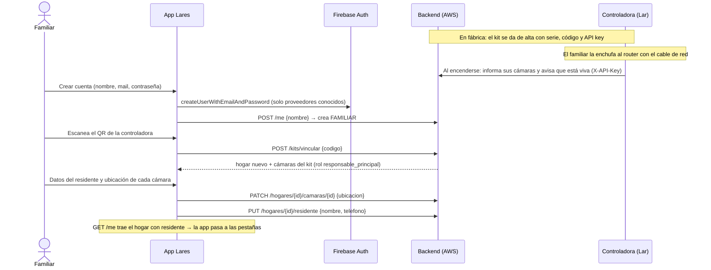
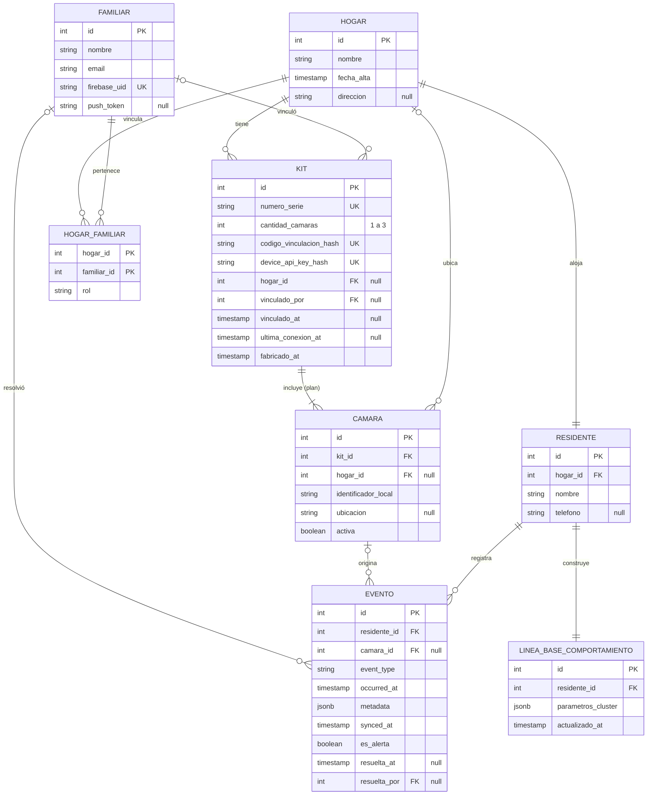

# Vinculación del kit por QR

Cómo un familiar que recibe un kit Lares lo conecta con su cuenta, qué ya está hecho en la app,
qué tiene que hacer el backend y **qué cambia en el diagrama de base de datos del informe**
(Figura 3.8, "Diagrama de base de datos en la nube").

> Estado (2026-10-04): la app tiene todo el flujo hecho y funcionando contra el **mock**. El
> backend todavía no tiene ninguno de los endpoints de este documento (`PENDIENTE BACKEND`).
>
> Actualizado (2026-10-05) con las decisiones tomadas al pasarlo al informe: push en FAMILIAR,
> sin INVITACION, `direccion` opcional, sin verificación de mail (proveedores permitidos), wifi
> validado para 3 cámaras, RF10 redefinido y RF14 nuevo.

---

## 1. El flujo



### Pasos en la app

| # | Pantalla | Qué pasa |
|---|---|---|
| — | Login → **Crear cuenta** | Nombre, mail, contraseña y confirmación, con validación en vivo. Sin mail de verificación: solo se aceptan correos de Gmail, Hotmail, Outlook, Yahoo o iCloud (`DOMINIOS_PERMITIDOS` en `src/lib/validaciones.ts`). |

**Requerimientos (informe):** RF10 = el familiar asigna desde la app la ubicación de cada cámara
del kit (paso 3). RF14 (nuevo) = vinculación del kit por QR (pasos 1 a 3).
| 1 | **Vinculá tu kit** | Instrucciones + "Escanear el código QR" o "Ingresar el código a mano". |
| 1 | Escáner | Cámara del celular (`expo-camera`). Si el QR no es de Lares, o el kit ya está vinculado, explica qué hacer. |
| 2 | **¿A quién vas a cuidar?** | Nombre del residente (obligatorio) y teléfono (opcional, lo usa "Llamar a…"). |
| 3 | **¿Dónde está cada cámara?** | Ubicación de cada cámara **del plan del kit** (1 a 3, viene definido de fábrica): con un plan de 1 cámara se carga una sola zona. Con sugerencias ("Living", "Puerta del baño"…). |

Cómo decide la app qué mostrar (según `GET /me`):

| Estado de la cuenta | Qué ve el familiar |
|---|---|
| Sin sesión | Login / Crear cuenta |
| Con sesión, `hogares: []` | Paso 1 (vincular el kit) |
| Un hogar con `residente: null` | Paso 2 (retoma la configuración si se cerró la app a mitad) |
| Un hogar con residente | Las pestañas de siempre |

Por eso el residente se guarda **al final del paso 3**: tener residente es la señal de
"configuración terminada".

---

## 2. Instalación física: enchufar y listo

El kit se entrega preconfigurado (informe, Sección 3.8) y el familiar no configura nada en la
controladora ni en las cámaras.

| Pregunta | Respuesta |
|---|---|
| ¿Hace falta monitor, teclado o mouse? | **No.** La controladora (Lar) corre sin pantalla, con el sistema y el software instalados de fábrica. |
| ¿Cómo se conecta a internet? | **Con un cable de red** de la controladora al router de la casa. Sin contraseñas ni configuración. El cable **no viene en el kit**: lo pone el familiar (la mayoría de los routers traen uno). |
| ¿Cómo se conectan las cámaras? | A una **red wifi privada que arma la propia controladora**. Las cámaras (Vela) vienen configuradas de fábrica para conectarse solo a esa red. |
| ¿Cómo se "levanta" el sistema? | Solo. El runner y el panel local arrancan al encender la controladora (servicios de `systemd`) y vuelven a arrancar después de un corte de luz. |
| ¿Y el panel de control local? | **Opcional.** La familia puede abrirlo desde un navegador en la red de la casa, en una dirección fija tipo `http://lar.local` (mDNS), pero no hace falta: todo lo necesario se hace desde la app. También lo usa el soporte técnico, **solo de forma presencial** (no hay acceso remoto). |
| ¿Cómo sabe el familiar si funciona? | Por la **luz de estado** de la controladora y por la app. |

### Por qué una red privada para las cámaras

Las cámaras **no tienen salida a internet**: solo ven a la controladora. Así es técnicamente
imposible que manden video a la nube del fabricante, que es justo el problema de las cámaras
domésticas que describe la Sección 3.8 del informe. Es una garantía de privacidad (RNF1) más
fuerte que "no lo configuramos para que lo mande".

Como la controladora sale a internet por cable, su wifi queda libre para la red de las cámaras.
**Probado con el hardware:** el wifi de la Raspberry Pi 5 sostiene como punto de acceso las 3
cámaras transmitiendo en simultáneo, así que no hace falta un adaptador USB.

### Luz de estado

| Luz | Significa | Qué hace el familiar |
|---|---|---|
| Ámbar titilando | Encendida, sin internet | Revisar el cable de red |
| Verde titilando | Con internet, esperando la vinculación | Escanear el QR desde la app |
| Verde fija | Funcionando | Nada |
| Roja | Problema (ej. no ve ninguna cámara) | La app le dice cuál |

La app muestra lo mismo en palabras a partir de `KIT.ultima_conexion_at` (ver sección 4): si la
controladora no avisa hace un rato, "Lar no tiene internet desde las 14:20".

### Conectar por wifi en vez de cable (a futuro)

Para casas sin el router a mano: la app le pasa a la controladora el nombre y la contraseña del
wifi **por Bluetooth**, como hacen Google Home o Chromecast. Requiere una librería nativa de
Bluetooth en la app (no anda en Expo Go; se puede sumar cuando se pase a *development build*
por las push) y un servicio Bluetooth en la controladora. Alternativa sin app: que la
controladora arme una red propia con una página para elegir el wifi (ej. `wifi-connect` de
balena), menos amigable para quien no sabe de tecnología. Para el prototipo y la demo, el cable.

---

## 3. El QR y el código

Cada kit sale de fábrica con una etiqueta en la base de la controladora:

```
┌────────────────────────────┐
│  [QR]    Kit Lares         │
│          LR-000123         │   ← número de serie (informativo)
│          7K3P-9QXM         │   ← código de vinculación
└────────────────────────────┘
```

- **Contenido del QR:** `lares://vincular?serie=LR-000123&codigo=7K3P9QXM`.
  El esquema `lares://` es el de la app (`app.json`): en un build propio, escanear el QR con la
  cámara del celular podría abrir la app directo en la vinculación (a futuro).
- **Código:** 8 caracteres del alfabeto **Crockford base32** (`0-9` y letras sin `I L O U`),
  para que no se confundan al tipearlo. La app acepta minúsculas, espacios, guiones y corrige
  `O→0`, `I/L→1`. ~10¹² combinaciones.
- **Número de serie:** `LR-` + 6 dígitos. Sirve para soporte y para mostrarlo en Perfil; para
  vincular alcanza con el código.

Implementación en la app: `src/features/vinculacion/codigoKit.ts`.

---

## 4. Cambios al diagrama de base de datos (Figura 3.8)

### Resumen

| Entidad | Cambio | Prioridad |
|---|---|---|
| **KIT** | **Nueva** (incluye `ultima_conexion_at` para saber si Lar está en línea) | Imprescindible para el QR |
| HOGAR | Pasa `device_api_key_hash` a KIT; `nombre`, `fecha_alta` y `direccion` (opcional) | Imprescindible para el QR |
| RESIDENTE | + `telefono` | Imprescindible (lo usa la app hoy) |
| EVENTO | + `resuelta_at`, `resuelta_por`; `camara_id` pasa a opcional | Imprescindible (lo usa la app hoy) |
| CAMARA | + `kit_id`; `hogar_id` opcional hasta vincular; la cantidad la fija el plan del kit | Imprescindible para el QR |
| FAMILIAR | + `push_token` (null), para las notificaciones push | Necesaria para RF8 |
| HOGAR_FAMILIAR | Sin cambios de estructura; se definen los valores de `rol` | — |
| LINEA_BASE_COMPORTAMIENTO | Sin cambios; falta decidir si se usa | A definir |

### Entidades, campo por campo

Convenciones: **PK** clave primaria, **FK** clave foránea, **UQ** único, **null** admite nulo.
Los tipos son los del diagrama actual (PostgreSQL).

#### KIT (nueva)

Un kit físico: la controladora Lar con sus cámaras Vela. Existe desde fábrica, antes de que
haya un hogar.

| Campo | Tipo | Notas |
|---|---|---|
| id | int | **PK** |
| numero_serie | string | **UQ**. "LR-000123" |
| cantidad_camaras | int | **Plan comprado, de 1 a 3** (informe, Sección 3.9.2.1: el kit trae 1 cámara y se suman hasta 3 por controladora). Es el máximo de cámaras que el hogar puede configurar |
| codigo_vinculacion_hash | string | **UQ**. SHA-256 del código del QR; el código nunca se guarda en claro |
| device_api_key_hash | string | **UQ**. Credencial con la que la controladora manda eventos (hoy está en HOGAR) |
| hogar_id | int | **FK → HOGAR**, **null** hasta que alguien escanea el QR |
| vinculado_por | int | **FK → FAMILIAR**, **null**. Quién lo vinculó (auditoría) |
| vinculado_at | timestamp | **null** |
| ultima_conexion_at | timestamp | **null**. La controladora avisa cada pocos minutos que está viva; la app muestra "conectado" o "sin internet desde…" |
| fabricado_at | timestamp | Alta del kit en fábrica |

**Por qué una entidad aparte y no campos en HOGAR:** la credencial es del aparato, no de la
casa. Si la controladora se rompe y se cambia, se da de baja el kit viejo y se vincula uno nuevo
al **mismo** hogar, sin perder el historial de eventos ni la línea base. Además el kit existe
antes que el hogar (en fábrica), y HOGAR no tendría con qué completarse.

#### HOGAR (modificada)

| Campo | Tipo | Notas |
|---|---|---|
| id | int | **PK** |
| nombre | string | "Casa de Rosa". La app lo arma con el nombre del residente |
| fecha_alta | timestamp | Momento de la vinculación |
| direccion | string | **null**. Se mantiene opcional; la app hoy no la pide |
| ~~device_api_key_hash~~ | | **Pasa a KIT** (hoy está en `cloud/app/models.py`) |

#### RESIDENTE (modificada)

| Campo | Tipo | Notas |
|---|---|---|
| id | int | **PK** |
| hogar_id | int | **FK → HOGAR**, **UQ** (1:1, RNF11) |
| nombre | string | |
| telefono | string | **null**. Nuevo. Formato internacional E.164 ("+5491123456789"); lo valida la app |

#### CAMARA (modificada)

Las cámaras del plan **se crean en fábrica junto con el kit** (tantas como `cantidad_camaras`),
ya emparejadas con la controladora. Al vincular, el backend les asigna el hogar.

| Campo | Tipo | Notas |
|---|---|---|
| id | int | **PK** |
| kit_id | int | **FK → KIT**. Nuevo: a qué kit pertenece la cámara física |
| hogar_id | int | **FK → HOGAR**, **null** hasta la vinculación (antes era obligatorio) |
| identificador_local | string | El `id` de `cameras.yaml` en la controladora ("cam1"). **UQ junto con kit_id** |
| ubicacion | string | **null** hasta que el familiar la carga en el paso 3 |
| activa | boolean | |

En el código del backend `identificador_local` se llama `local_id`; conviene unificar el nombre.

**Regla:** un kit nunca tiene más cámaras que su `cantidad_camaras`. El backend la hace
cumplir en dos lugares: al crear las cámaras en fábrica, y si la controladora intenta registrar
una cámara de más (`POST /camaras` → 409 "el plan de este kit es de N cámaras"). Para pasar a un
plan más grande, se actualiza `cantidad_camaras` (venta de cámara adicional, USD 19 con IVA;
USD 15 es el costo) y se crea la cámara nueva.

#### EVENTO (modificada)

| Campo | Tipo | Notas |
|---|---|---|
| id | int | **PK** |
| residente_id | int | **FK → RESIDENTE** |
| camara_id | int | **FK → CAMARA**, **null**. Los desvíos de rutina no vienen de una cámara (el código ya lo hace así) |
| event_type | string | |
| occurred_at | timestamp | |
| metadata | jsonb | |
| synced_at | timestamp | |
| es_alerta | boolean | |
| resuelta_at | timestamp | **null**. Nuevo: cuándo se marcó como atendida ("Marcar como resuelta") |
| resuelta_por | int | **FK → FAMILIAR**, **null**. Nuevo: quién la atendió |

#### FAMILIAR (modificada)

| Campo | Tipo | Notas |
|---|---|---|
| id | int | **PK** |
| nombre | string | |
| email | string | De un proveedor permitido (Gmail, Hotmail, Outlook, Yahoo, iCloud); no se verifica por mail |
| firebase_uid | string | **UQ** |
| push_token | string | **null**. Nuevo: token de FCM del celular para las push (RF8). Se pisa al iniciar sesión o cuando FCM lo renueva |

Se crea con `POST /me` justo después de crear la cuenta en Firebase. Un solo token por familiar:
si inicia sesión en otro celular, las push pasan a llegar a ese (como propone `cloud/README.md`).

#### HOGAR_FAMILIAR (sin cambios de estructura)

`hogar_id` PK+FK, `familiar_id` PK+FK, `rol`. Valores de `rol`:
- `responsable_principal`: quien vinculó el kit. Puede invitar y quitar familiares.
- `familiar`: solo ve alertas y reportes.

**Invitaciones:** no hay tabla de invitaciones. Solo se invita a familiares que **ya tienen
cuenta**: el responsable principal ingresa el mail y el backend crea directamente la fila de
HOGAR_FAMILIAR (como propone `cloud/README.md`, punto 4).

#### LINEA_BASE_COMPORTAMIENTO (sin cambios)

Está en el diagrama pero no en `cloud/app/models.py`. Falta decidir si `baseline/` guarda ahí
sus parámetros o si la línea base se recalcula cada vez. Reportes ("habitual 7:00–7:45")
necesita esos rangos de algún lado.

### Relaciones nuevas o que cambian

| Relación | Cardinalidad | Lectura |
|---|---|---|
| HOGAR — KIT | 1 : 0..N | Un hogar tiene un kit activo (y los anteriores, si se reemplazó). Un kit pertenece a 0 o 1 hogar |
| KIT — CAMARA | 1 : 1..3 | Las cámaras del plan, creadas en fábrica (`cantidad_camaras`) |
| HOGAR — CAMARA | 0..1 : 0..N | Cambia: la cámara recibe el hogar recién al vincular |
| FAMILIAR — KIT (`vinculado_por`) | 1 : 0..N | Quién vinculó cada kit |
| FAMILIAR — EVENTO (`resuelta_por`) | 1 : 0..N | Quién atendió cada alerta |
| CAMARA — EVENTO | 0..1 : 0..N | Ahora opcional del lado del evento |

Las demás quedan igual: HOGAR 1:1 RESIDENTE, FAMILIAR N:M HOGAR (vía
HOGAR_FAMILIAR), RESIDENTE 1:N EVENTO, RESIDENTE 1:1 LINEA_BASE_COMPORTAMIENTO.

### Diagrama completo (para rehacer la figura)



GitHub y VS Code (con la extensión de Mermaid) dibujan este bloque; sirve de guía para rehacer
la figura en Lucidchart.

### Texto del informe a revisar

Si se actualiza la Figura 3.8, también cambian estas partes del cap. 3, Sección 3.5.2:
- La descripción de HOGAR (`direccion` opcional) y la entidad nueva KIT, con el motivo de
  separarla.
- FAMILIAR: `push_token`.
- EVENTO: `camara_id` opcional y los campos de resolución.
- Sección 3.8 (Viabilidad Técnica) ya dice que la ubicación de cada cámara se asigna desde la
  app: ahora está implementado así.

---

## 5. Contrato de la API (para el backend)

Todos con `Authorization: Bearer <firebase_id_token>`, salvo los de la controladora
(`X-API-Key`). Tipos en `src/api/types.ts`; métodos en `src/api/client.ts`.

| Método | Endpoint | Body | Respuesta | Errores |
|---|---|---|---|---|
| `crearPerfil` | `POST /me` | `{ nombre }` | `Perfil` | — (idempotente: si ya existe, lo devuelve) |
| `obtenerPerfil` | `GET /me` | — | `Perfil` (ver abajo) | 404 si no hay FAMILIAR |
| `vincularKit` | `POST /kits/vincular` | `{ codigo }` | `KitVinculado` | 404 código inexistente · 409 kit ya vinculado a otro hogar · 429 demasiados intentos |
| `listarCamaras` | `GET /hogares/{id}/camaras` | — | `Camara[]` | 403 |
| `actualizarCamara` | `PATCH /hogares/{id}/camaras/{camara_id}` | `{ ubicacion }` | `Camara` | 403 · 404 |
| `guardarResidente` | `PUT /hogares/{id}/residente` | `{ nombre, telefono }` | 204 | 403 · 422 |

```jsonc
// GET /me — cuenta recién vinculada, configuración a medias
{
  "familiar": { "id": 7, "nombre": "Ana Gómez", "email": "ana@mail.com" },
  "hogares": [{
    "id": 3, "nombre": "Mi hogar", "rol": "responsable_principal",
    "residente": null,                       // ← null = falta la configuración inicial
    "kit": { "numero_serie": "LR-000124", "cantidad_camaras": 1 }
  }]
}

// POST /kits/vincular → 200 (kit con plan de 1 cámara: viene exactamente 1)
{
  "hogar_id": 3,
  "numero_serie": "LR-000124",
  "cantidad_camaras": 1,
  "camaras": [{ "id": 11, "local_id": "cam1", "ubicacion": null, "activa": true }]
}
```

Los mensajes de error (`detail`) de 404/409/429 se muestran tal cual al familiar: conviene que
estén en español y digan qué hacer (ej. 409: "Este kit ya está vinculado a otro hogar. Pedile a
quien lo configuró que te invite desde su app.").

### Qué hace `POST /kits/vincular`

1. Busca el kit por `sha256(codigo)`. Si no existe → 404 (y cuenta el intento fallido).
2. Si `kit.hogar_id` ya está: si el familiar ya pertenece a ese hogar, devuelve lo mismo (un
   reintento por corte de conexión no tiene que fallar); si no → 409.
3. Si está libre, en **una transacción**: crea HOGAR, asigna `kit.hogar_id`, `vinculado_por`,
   `vinculado_at`, crea HOGAR_FAMILIAR con rol `responsable_principal`, y les asigna el hogar a
   las CAMARA del kit (las del plan, creadas en fábrica). Devuelve `cantidad_camaras` y esas
   cámaras: la app pide la ubicación **solo** de ellas.

### Seguridad

- El código se guarda **hasheado** (como hoy la API key).
- **Límite de intentos** por familiar y por IP (ej. 5 fallidos → esperar 15 min): con 8
  caracteres no se adivina, pero evita barridos.
- El 404 no distingue "no existe" de "mal tipeado".
- **Un solo uso**: una vez vinculado, el mismo QR no sirve para otra cuenta (409). Los demás
  familiares entran por invitación.
- Si se desvincula un kit (venta, reemplazo), se genera un código nuevo y se reimprime la
  etiqueta.

### Lado de la controladora (Raspberry)

- En fábrica: se generan serie, código y API key; la API key queda en la controladora y el
  código se imprime en la etiqueta. Se cargan el plan (`cantidad_camaras`) y las cámaras del
  plan, ya emparejadas con la red privada de la controladora.
- Al encenderse, la controladora informa el estado de sus cámaras (cuáles ve). El endpoint que
  ya existe (`POST /camaras`, con `X-API-Key`) tiene que rechazar una cámara que exceda el plan
  (409), para que nadie sume cámaras sin comprarlas.
- Cada pocos minutos avisa que está viva (un "latido", con `X-API-Key`): actualiza
  `KIT.ultima_conexion_at`. Con eso la app muestra si Lar está conectado y puede esperar a que
  esté en línea antes del paso de cámaras.
- Mientras el kit no tiene hogar, `POST /events` debería responder 409 ("kit sin vincular") y la
  controladora guarda los eventos localmente, igual que ante un corte de conexión (RNF6/RNF7).

---

## 6. Cómo probarlo hoy (modo mock)

- **Crear cuenta** desde el Login con un mail de Gmail, Hotmail, Outlook, Yahoo o iCloud (no
  `ana.gomez@mail.com`, que es la demo). Con otro dominio, la app muestra el error.
- Códigos de prueba (`src/api/mock.ts` → `KITS_DEMO`):

| Serie | Código | Para probar |
|---|---|---|
| LR-000124 | `4HDW-8R2N` | Plan de **1 cámara**: el paso 3 pide una sola ubicación |
| LR-000125 | `M2VC-5ZKA` | Plan de **2 cámaras** |
| LR-000123 | `7K3P-9QXM` | Plan de **3 cámaras** (el máximo) |
| LR-000101 | `Q9TB-6XJV` | Ya vinculado a la cuenta demo → error 409 |

- Para el escáner, generar un QR con el texto `lares://vincular?serie=LR-000123&codigo=7K3P9QXM`
  (cualquier generador de QR online sirve) y apuntarle con el celular.
- Las cuentas y vinculaciones del mock se pierden al recargar la app.

## 7. Decisiones

**Cerradas (2026-10-05, al pasar esto al informe):**
- **Invitaciones (RF12):** sin tabla INVITACION; solo se invita a familiares que ya tienen
  cuenta.
- **`direccion` en HOGAR:** se mantiene, opcional.
- **Verificación de mail:** se elimina. No se manda mail de verificación; al crear la cuenta solo
  se aceptan proveedores conocidos (`validarEmailRegistro` en `src/lib/validaciones.ts`).
- **Push:** `push_token` en FAMILIAR (un celular por familiar), sin tabla aparte.
- **Wifi de la controladora:** probado con 3 cámaras, sin adaptador USB.
- **Panel local:** opcional para la familia; soporte técnico solo presencial.

**Abiertas:**
- **Varios hogares por familiar:** el modelo lo permite (N:M), pero la app hoy usa el primero.
  Vincular un segundo kit desde Perfil queda para más adelante.
